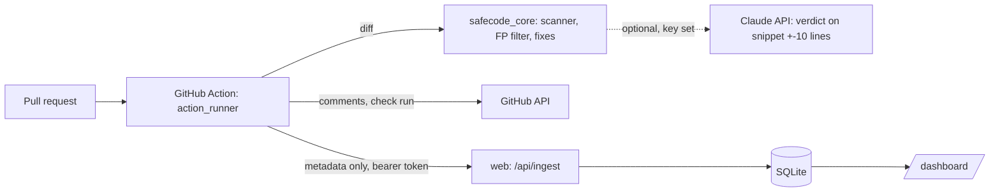

# SafeCode AI (MVP v2, reduced scope)

SafeCode AI uses its own engine on Python's AST with 5 rules (not Semgrep, although the original spec planned it). It is a GitHub Action that scans only the lines changed in a pull request for Python security bugs, filters out false positives with a reason, posts a summary comment plus inline `suggestion` fixes (Russian or English), sets a pass/fail check, and sends scan metadata (never source code) to a small dashboard.

The summary headline looks like this, on the demo PR: **5 raw → 2 real, 3 filtered (60% noise removed)**.

## Run it (no API key needed)

```bash
pip install -r requirements.txt
python -m pytest -q                                   # 32 tests
python scripts/dryrun.py                              # whole demo loop offline, prints the PR comments
INGEST_TOKEN=dev-token python -m uvicorn web.app:app --port 8765   # then open http://localhost:8765/dashboard
```

Real GitHub setup: see [SETUP.md](SETUP.md). Defence plan with backups: [demo/DEMO_SCRIPT.md](demo/DEMO_SCRIPT.md).

## What is real, simulated, planned

| Item | Status | Notes |
|---|---|---|
| GitHub Action: diff, scan changed lines, summary comment (updated in place), inline `suggestion` comments, check run | **REAL**, but see "Not verified live" | Logic is tested against an in-memory GitHub; the real GitHub API has not been called yet |
| Python rules: SQL injection, hardcoded secret, weak hash, insecure random, `subprocess shell=True` | **REAL** | stdlib `ast`, no Semgrep |
| False-positive heuristics + reasons | **REAL** | tests, constant SQL, md5/sha1 away from password names, random away from token names, literal commands |
| Rule-based fixes, RU and EN text | **REAL** | Every fix is labelled "Rule-based fix" |
| LLM verdict layer (Anthropic or OpenAI) | **REAL, verified with OpenAI `gpt-4o-mini`, OFF by default** | Verified live on 6 scans of the demo PR. Anthropic path is mock-tested only. With the first prompt the model overturned the heuristics (4 real, 20% noise); after the prompt encoded the false-positive criteria it gave 2 real / 3 filtered on 3 of 3 scans. A scan takes about 6 s instead of 0.4 s (about 1,300 input and 130 output tokens). Rule-based fixes are unchanged: the AI only judges |
| AI-written fixes | **PLANNED** | The LLM only gives a verdict today; fixes are always rule-based |
| Dashboard "REAL" block (PR scans, findings, filtered %, accepted fixes, scan time, cost per scan) | **REAL** | Starts at zero, fills only from ingested scans |
| Dashboard "SIMULATED" block (six Sept 2027 KPIs) | **SIMULATED** | Plan values; statuses computed from the threshold rules |
| Free scan page, report page, feedback votes, UI language switch, demo mode, JS rules, Kazakh texts | **PLANNED** | Cut for the 8-hour deadline |
| Roadmap: GitHub App/OAuth, GitLab, Slack/Jira, billing, VS Code extension, on-prem and local data residency for banks, SSO, audit log | **PLANNED** | None of it exists |

Pricing (proposed, not purchasable): Free · Team 125,000 KZT per team per month · Enterprise (custom, 60-day free pilot for banks).

### Roadmap (planned only)
1. GitHub App for organizations (no per-repo workflow file) 2. JavaScript/TypeScript rules 3. Kazakh texts 4. Free scan page and feedback votes 5. GitLab 6. Slack and Jira 7. Monthly "hours saved" report 8. On-prem for banks 9. Team seats, SSO, audit log.

## Architecture



How "accepted fix" is counted: a real finding that vanishes in a later scan of the same PR with a different head SHA. That is a proxy (the developer might also have deleted the code), and the dashboard says so.

## Data and privacy

The Action runs inside your GitHub runner. Only finding snippets (flagged lines ±10) go to the LLM, and only if you set `ANTHROPIC_API_KEY`. Ingest sends metadata only: repo, PR number, SHA, rule, severity, file, line, filtered flag and reason, fix source, duration, tokens, cost. No source code is sent or stored. Local data residency is PLANNED for enterprise, not implemented.

## Known limitations

- Python only, five rules, line-level heuristics. A SQL string built in one statement and executed in another (`q = f"..."; db.execute(q)`) is flagged without an automatic fix.
- The SQL fix uses `?` placeholders (sqlite3 style); psycopg needs `%s`. The weak-hash fix swaps to SHA-256 and says to use bcrypt/scrypt/argon2 for real password storage.
- Inline comments on lines outside the PR diff are rejected by GitHub; they are logged and still listed in the summary.
- PRs from forks get a read-only token, so comments and checks fail there. Use same-repo branches.
- Inline threads are not resolved through the API; the Action replies "Resolved" and strikes the finding in the summary.
- The dashboard has no login. Anyone with the URL sees the numbers; only ingest needs the token.
- Cost per scan is 0 unless you set `LLM_PRICE_INPUT_PER_1K_KZT` and `LLM_PRICE_OUTPUT_PER_1K_KZT`; I did not invent prices.

## Decisions

- Stdlib `ast` instead of Semgrep: Semgrep does not run natively on Windows and the five rules need only a syntax tree. The Action has zero pip dependencies (faster, nothing to break).
- stdlib `sqlite3` instead of SQLAlchemy/Postgres. A hosted free tier with an ephemeral disk loses data on restart, so SETUP.md recommends running the dashboard locally behind a tunnel for the defence.
- Dashboard noise percentage uses the first scan of each PR (what the developer sees first). After the fix commit the same PR shows 100%, which would hide the story.
- Dry-run keeps fake PR state in a JSON file so a second run behaves like a re-run on the same PR.
- No lint/CI workflow for this repo, no Docker/Replit/Render config beyond a minimal `Dockerfile`.

## Changelog

Prototype v1 (Replit): Semgrep wrapper, no AI fixes, no PR integration. MVP v2 (this repo): PR integration with an Action, false-positive filter with reasons, rule-based fixes as GitHub suggestions, ingest API and live dashboard.

## AI contribution

Claude Code generated all code, tests and docs in this repo from `SAFECODE_MVP_SPEC.md` plus a reduced-scope brief. The team has to fill in the verification column.

| Module | Own / AI-assisted / AI-generated | Tool and purpose | How verified |
|---|---|---|---|
| Engine (`safecode_core`) | AI-generated | Claude Code: rules, FP filter, fixes, LLM layer | _team to fill_ |
| Action (`action_runner`, `action.yml`) | AI-generated | Claude Code: diff, comments, check, ingest | _team to fill_ |
| Web (`web/`) | AI-generated | Claude Code: ingest API, dashboard | _team to fill_ |
| Fix texts RU/EN | AI-generated | Claude Code: Russian and English wording | _team to fill (native review)_ |
| Demo kit and docs | AI-generated | Claude Code | _team to fill_ |

## Not verified live

Everything is tested offline (32 tests, dry-run, a local uvicorn plus browser check of the dashboard). The Action has not run on real GitHub: the REST calls follow GitHub's documented endpoints but have never hit them. Do the rehearsal in SETUP.md step 7 before the defence.
